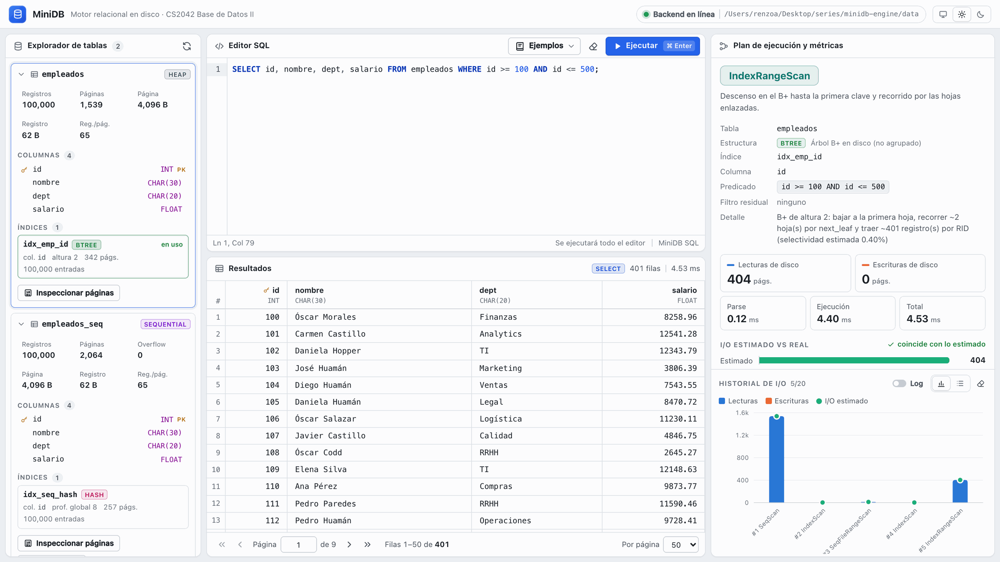

# MiniDB — Gestor de bases de datos multimodal en disco

[](https://github.com/josueTori-UTEC/minidb-engine/actions/workflows/tests.yml)

Proyecto del curso **Base de Datos II (CS2042) — UTEC 2026-II**, Entregables 1 y 2.

MiniDB es un mini gestor de bases de datos construido desde cero que opera
directamente sobre memoria secundaria: todos los datos e índices viven en archivos binarios
paginados que se leen y escriben de a una página completa (`seek` + `read`/`write` con
`struct`), sin motores de bases de datos, ORMs, `pickle` ni JSON para persistir. Sobre el
motor relacional del Entregable 1, el Entregable 2 agrega datos espaciales, texto libre y
vectores de alta dimensión, un planificador híbrido y una aplicación de IA (recomendador
multimodal de productos).

| Entregable 2 | Dónde está |
|---|---|
| R-Tree en disco: inserción por mínimo ΔÁrea, split cuadrático, ventana, radio y k-NN con cola de prioridad (MINDIST) | [`backend/indexes/rtree.py`](backend/indexes/rtree.py) |
| Visor de mapa (Leaflet) con los resultados, el círculo de la consulta y los MBR visitados | [`frontend/src/components/ResultsMap.tsx`](frontend/src/components/ResultsMap.tsx) |
| Índice invertido en disco (`vocab.dic`, `postings.inv`, `docs.bin`) construido con SPIMI; consultas booleanas por mezcla de listas y ranking TF-IDF + coseno con Top-K | [`backend/indexes/inverted_index.py`](backend/indexes/inverted_index.py), [`backend/text/`](backend/text) |
| Descriptores de imagen: Bag of Visual Words (SIFT + K-Means) y embeddings densos (ResNet-18 + PCA) | [`backend/ml/features.py`](backend/ml/features.py), [`data/prepare_fashion.py`](data/prepare_fashion.py) |
| k-NN exacto y ANN con IVF-Flat en disco (`ivf.dir`, `ivf.lst`), `SET ivf.probes` | [`backend/indexes/ivf.py`](backend/indexes/ivf.py) |
| SQL extendido: `POINT`, `TEXT`, `VECTOR(n)`, `USING RTREE \| INVERTED \| IVF WITH (...)`, `WITHIN_RADIUS`, `MATCH`, `COSINE_SCORE()`, `<->`, `<=>`, `ORDER BY … LIMIT` | [`backend/sql/parser.py`](backend/sql/parser.py) |
| Planificador híbrido (pre-filtering vs post-filtering) con I/O separado por índice y por tabla | [`backend/sql/multimodal.py`](backend/sql/multimodal.py) |
| Aplicación de IA (Opción B): recomendador multimodal de e-commerce | [`backend/app/recommender.py`](backend/app/recommender.py), pestaña **Recomendador** del cliente |
| Experimentos 5 a 8 y comparación de estrategias híbridas | [`benchmarks/`](benchmarks) |
| Informe disponible | [`docs/informe/informe_e2.pdf`](docs/informe/informe_e2.pdf) |

| Entregable 1 | Dónde está |
|---|---|
| Páginas de tamaño fijo con header, RID `⟨page_id, slot⟩` y `DiskCounter` | [`backend/storage/`](backend/storage) |
| Heap File con Free-List | [`backend/files/heap_file.py`](backend/files/heap_file.py) |
| Sequential File (área principal ordenada, overflow encadenado, `reorganize` con fill factor 0.75) | [`backend/files/sequential_file.py`](backend/files/sequential_file.py) |
| Árbol B+ multinivel en disco (split, búsqueda puntual y por rango) | [`backend/indexes/bplus_tree.py`](backend/indexes/bplus_tree.py) |
| Hashing dinámico en disco (Extendible Hashing) | [`backend/indexes/extendible_hash.py`](backend/indexes/extendible_hash.py) |
| Parser SQL propio: `CREATE TABLE`, `INSERT`, `SELECT ... WHERE`, `DELETE`, `CREATE INDEX` | [`backend/sql/`](backend/sql) |
| Planner (SeqScan / IndexScan / IndexRangeScan) con I/O exacto y latencia en ms | [`backend/sql/planner.py`](backend/sql/planner.py) |
| API REST (`POST /api/query`, `GET /api/tables`, `POST /api/tables/reorganize`) | [`backend/api/main.py`](backend/api/main.py), [`docs/api.md`](docs/api.md) |
| Cliente web con 4 paneles (explorador, editor SQL, resultados, plan y métricas) | [`frontend/`](frontend) |
| Datos sintéticos ≥ 100 000 registros y 4 experimentos automatizados | [`data/generate.py`](data/generate.py), [`benchmarks/`](benchmarks) |
| Informe en PDF  | [`docs/informe/informe.pdf`](docs/informe/informe.pdf) |

**Integrantes:** Renzo Acervo, Josué Toribio, Lisseth Rondan.



---

## 1. Levantar todo en un solo paso

Requisito: Docker Desktop (o Docker Engine con Compose v2).

```bash
docker compose up --build
```

| Servicio | URL |
|---|---|
| Cliente web (4 paneles) | <http://localhost:5173> |
| API REST | <http://localhost:8000> — documentación interactiva en <http://localhost:8000/docs> |

Los archivos binarios (`catalog.bin`, `*.heap`, `*.seq`, `*.ovf`, `*.bpt`, `*.hsh`, `*.rtr`,
`*.vocab.dic`, `*.postings.inv`, `*.docs.bin`, `*.ivf.dir`, `*.ivf.lst`) se guardan en
`./data` (montado como volumen en `MINIDB_DATA_DIR=/app/data`), así que todo sobrevive a un
reinicio de los contenedores.

### Cargar 100 000 registros de prueba

1. Generar el CSV sintético (semilla fija, ids únicos en orden aleatorio):

   ```bash
   docker compose exec backend python data/generate.py --n 100000 --seed 42
   ```

   (o sin Docker: `python3 data/generate.py --n 100000 --seed 42`; solo usa la biblioteca estándar).
   Deja `data/empleados.csv`, que no se versiona.

2. En el cliente web (menú **Ejemplos**) o con `curl`, ejecutar:

   ```sql
   CREATE TABLE empleados (id INT PRIMARY KEY, nombre CHAR(30), dept CHAR(20), salario FLOAT) USING HEAP;
   COPY empleados FROM 'empleados.csv';
   CREATE INDEX idx_emp_id ON empleados (id) USING BTREE;
   SELECT * FROM empleados WHERE id = 101;
   SELECT * FROM empleados WHERE id >= 100 AND id <= 500;
   ```

   ```bash
   curl -s localhost:8000/api/query -H 'Content-Type: application/json' \
        -d '{"sql": "SELECT * FROM empleados WHERE id = 101"}'
   ```

Cada respuesta trae las filas (paginadas), el plan elegido con su costo estimado y los
candidatos que se descartaron, y las métricas exactas: `disk_reads`, `disk_writes`,
`parse_ms`, `exec_ms` y `total_ms`. En la barra del editor, el selector **Planner** cambia entre
las reglas del enunciado (por defecto) y el optimizador por costos (campo `planner` de la API).
El visor de resultados copia al portapapeles en CSV las filas que muestra.

### Cargar el catálogo multimodal (Entregable 2)

La aplicación de IA trabaja sobre una sola tabla, `productos`: 44 072 productos de
*Fashion Product Images (Small)* con su descripción, precio, tienda (punto geográfico en Lima),
palabras visuales (BoVW) y embedding de 128 dimensiones. Ni las imágenes ni los binarios se
versionan; un único script descarga el dataset, extrae las características, crea la tabla y
construye los seis índices:

```bash
docker compose exec backend python data/prepare_fashion.py --load
```

(sin Docker: `pip install -r requirements-ml.txt` y `python data/prepare_fashion.py --load`).
Necesita conexión para bajar el dataset y los pesos de ResNet-18, y deja ~700 MB en `data/`
(`media/` con las imágenes, `productos.csv`, `models/` con el codebook y la PCA). Con
`--limit 5000` prepara un catálogo reducido en un par de minutos; con `--only-load` reutiliza
un `productos.csv` ya generado y solo carga la tabla y los índices.

```sql
CREATE TABLE productos (id INT PRIMARY KEY, titulo CHAR(64), ..., precio FLOAT, tienda CHAR(24),
                        ubicacion POINT, descripcion TEXT(200), imagen CHAR(16),
                        palabras TEXT(800), embedding VECTOR(128)) USING HEAP;
CREATE INDEX idx_prod_geo   ON productos (ubicacion)   USING RTREE;
CREATE INDEX idx_prod_texto ON productos (descripcion) USING INVERTED WITH (analyzer = 'english');
CREATE INDEX idx_prod_bovw  ON productos (palabras)    USING INVERTED WITH (analyzer = 'raw');
CREATE INDEX idx_prod_vec   ON productos (embedding)   USING IVF WITH (metric = 'COSINE');

-- tiendas a 2 km con zapatillas rojas, las más parecidas a un vector de consulta
SELECT id, titulo, precio FROM productos
WHERE ubicacion WITHIN_RADIUS((-77.0282, -12.1211), 2.0)
  AND descripcion MATCH 'red AND shoes' AND precio <= 150
ORDER BY embedding <=> [0.12, -0.03, ...] LIMIT 10;
```

En el cliente, la pestaña **Recomendador** recibe una imagen (o un producto del catálogo), un
presupuesto y una ubicación, y muestra los productos sugeridos, el mapa de tiendas, la sentencia
SQL que generó y el plan con su I/O. El menú **Ejemplos** trae consultas espaciales, de texto,
vectoriales e híbridas listas para ejecutar, y el visor de resultados dibuja en un mapa cualquier
resultado que tenga una columna `POINT`.


## 2. Desarrollo local (sin Docker)

```bash
python3.12 -m venv .venv && source .venv/bin/activate
pip install -r requirements-dev.txt             # + requirements-ml.txt para vectorizar imágenes
uvicorn backend.api.main:app --reload            # API en http://localhost:8000

cd frontend && npm install && npm run dev        # cliente en http://localhost:5173 (proxy /api -> :8000)
```

El cliente necesita Node ≥ 20.19 (o ≥ 22.12), como declara `frontend/package.json`. Con Docker da igual
la versión instalada: la imagen compila con Node 24.

Variables de entorno del backend:

| Variable | Default | Uso |
|---|---|---|
| `MINIDB_DATA_DIR` | `./data` | carpeta del catálogo y de los archivos binarios |
| `MINIDB_PAGE_SIZE` | `4096` | tamaño de página de las tablas nuevas (512–65536, potencia de 2) |
| `MINIDB_PLANNER` | `rules` | `rules` (reglas del enunciado) o `cost` (menor costo estimado) |
| `MINIDB_WARM_UP` | `1` | precargar el extractor de características al iniciar (`0` lo difiere al primer uso) |
| `MINIDB_CORS_ORIGINS` | `http://localhost:5173,...` | orígenes permitidos (`*` = todos) |

## 3. Tests

```bash
pytest            # 189 tests
```

Los mismos tests corren en GitHub Actions en cada push y cada pull request
([`.github/workflows/tests.yml`](.github/workflows/tests.yml)).

Cubren round-trip de header/página/registro/RID, **exactitud del contador** (insert en heap
= 1R + 1W, búsqueda en B+ = h lecturas, full scan = P lecturas, hash = 2 lecturas),
invariantes del B+ tras 20 000 inserts aleatorios (hojas ordenadas y enlazadas, misma
profundidad, altura acotada por log_M N), hash con duplicados y splits de directorio,
`reorganize` (conserva registros, vacía el overflow, respeta el fill factor, ordenamiento
externo), persistencia tras cerrar y reabrir, parser (casos válidos y errores con posición),
planner/executor de punta a punta, la API y **pruebas aleatorias diferenciales**: miles de
inserciones, borrados y búsquedas en cada estructura (y por SQL) comparadas contra un modelo en
memoria, con páginas pequeñas para forzar splits, overflow y reorganizaciones.

Del Entregable 2: el R-Tree (invariantes de los MBR, ventana, radio y k-NN contra fuerza bruta,
carga STR, persistencia), el índice invertido (analizador, SPIMI con varios bloques, booleanas
contra conjuntos en memoria, puntajes TF-IDF y BM25 contra el cálculo directo), IVF (recall con
todas las listas = exacto, inserción y borrado, métricas L2 y coseno) y las consultas
multimodales por SQL, incluidas las dos estrategias híbridas y el desglose de I/O. No necesitan
el catálogo ni las dependencias de `requirements-ml.txt`.

## 4. Benchmarks (8 experimentos del enunciado)

```bash
python -m benchmarks.run_all           # corrida completa de los 8 experimentos
python -m benchmarks.run_all --quick   # verificación rápida (~30 s)
python -m benchmarks.run_all --only 3  # un experimento
```

Cada experimento corre sobre archivos nuevos (`benchmarks/work/`, no versionado), con semilla
fija, y guarda CSV + PNG en [`benchmarks/results/`](benchmarks/results) (sí versionados):

| Experimento | Script | Resultados |
|---|---|---|
| 1. Inserción masiva, N ∈ {1e3, 1e4, 5e4, 1e5, 2.5e5, 5e5} | `exp1_insert.py` | `exp1_insert.csv`, `exp1_*.png` |
| 2. 1000 búsquedas de igualdad sobre 100 000 registros | `exp2_equality.py` | `exp2_equality.csv`, `exp2_equality.png` |
| 3. Rangos con selectividad 0.1 %, 1 %, 5 %, 10 %, 25 % | `exp3_range.py` | `exp3_range.csv`, `exp3_range.png` |
| 4. Tamaño de página B ∈ {1024, 2048, 4096, 8192} | `exp4_block_size.py` | `exp4_block_size.csv`, `exp4_*.png` |
| 5. R-Tree vs scan secuencial (radio y k-NN, N ∈ {1e3 … 1e5}) y dimensión D ∈ {2 … 64} | `exp5_spatial.py` | `exp5_spatial.csv`, `exp5_dimension.csv`, `exp5_*.png` |
| 6. Índice invertido propio vs GIN de PostgreSQL (`tsvector`) | `exp6_text.py` | `exp6_build.csv`, `exp6_queries.csv`, `exp6_*.png` |
| 7. BoVW vs embeddings: Precision@10 y costo por consulta | `exp7_bovw_vs_embeddings.py` | `exp7_precision.csv`, `exp7_cost.csv`, `exp7_*.png` |
| 8. ANN (IVF) vs k-NN exacto: Recall@10 y lecturas según `probes` | `exp8_ann.py` | `exp8_ann.csv`, `exp8_recall.png` |
| Estrategias híbridas: pre-filtering vs post-filtering | `hybrid_strategies.py` | `hybrid_strategies.csv` |

Los experimentos 6, 7 y 8 usan el catálogo `productos` ya cargado. El 6 además necesita un
PostgreSQL local (variable `MINIDB_PG_DSN`; por defecto prueba la base del usuario y `postgres`): crea una base temporal, mide y
la elimina; si no hay servidor, omite esa columna.

Resultados principales (B = 4096, 44 072 productos):

| Consulta | Con índice | Sin índice |
|---|---|---|
| k-NN espacial, k = 5, N = 100 000 | 12 lecturas (R-Tree) | 1 235 lecturas |
| Top-10 por texto (TF-IDF + coseno) | 128–252 lecturas, 6–21 ms | 2 320 lecturas, ~600 ms |
| 10 imágenes más parecidas (embedding) | 212 lecturas, 3 ms, Recall@10 = 95.9 % (IVF, 5 probes) | 22 036 lecturas, ~880 ms |
| Precision@10 por tipo de artículo | 0.79 embeddings | 0.51 BoVW |

El análisis contra el costo teórico está en el informe. Las lecturas y escrituras son deterministas:
repetir los experimentos 2, 3 y 4 en otra máquina (macOS arm64 y Windows AMD64) da las mismas columnas
de I/O hasta la desviación estándar, y solo cambian los tiempos.

## 5. Inspeccionar los archivos binarios

```bash
python -m backend.tools.dump_page data/empleados.heap 0      # página 0: metadatos del archivo
python -m backend.tools.dump_page data/empleados.heap 1      # header + bitmap + registros + hexdump
python -m backend.tools.dump_page data/empleados_id.bpt 1    # nodo del B+ (claves y RIDs)
python -m backend.tools.dump_page data/empleados.seq --all   # header de todas las páginas
```

(Dentro de Docker: `docker compose exec backend python -m backend.tools.dump_page data/empleados.heap 1`.)
El cliente web tiene el mismo inspector (botón **Inspeccionar páginas** de cada tabla), que usa
`GET /api/tables/{tabla}/pages/{page_id}?file=...`.

## 6. SQL soportado

```text
CREATE TABLE t (col TYPE [PRIMARY KEY], ...) [USING HEAP | SEQUENTIAL];
CREATE INDEX nombre ON t (col) [USING BTREE | HASH];
INSERT INTO t VALUES (lit, ...), (lit, ...);
SELECT * | col, ... FROM t [WHERE cond];
DELETE FROM t [WHERE cond];
DROP TABLE t;   DROP INDEX nombre;
COPY t FROM 'archivo.csv';          -- carga masiva desde MINIDB_DATA_DIR
EXPLAIN SELECT ... | EXPLAIN DELETE ...

cond := pred {AND pred}
pred := col op lit | lit op col | col BETWEEN lit AND lit      op := = | != | <> | < | <= | > | >=
TYPE := INT | INTEGER | FLOAT | CHAR(n) | VARCHAR(n)
```

Extensiones del Entregable 2:

```text
TYPE := ... | POINT | TEXT[(n)] | VECTOR(n)
CREATE INDEX nombre ON t (col) USING RTREE | INVERTED | IVF [WITH (opcion = valor, ...)];
    RTREE     sobre POINT
    INVERTED  sobre TEXT / CHAR            WITH (analyzer = 'spanish' | 'english' | 'raw', scoring = 'TFIDF_COSINE' | 'BM25')
    IVF       sobre VECTOR(n)              WITH (lists = C, metric = 'L2' | 'COSINE')
SELECT item, ... FROM t [WHERE cond] [ORDER BY expr [ASC | DESC]] [LIMIT k];
SET ivf.probes = 10;   SET hybrid.strategy = auto | pre | post;   SET text.analyzer = spanish;

pred := ... | col WITHIN_RADIUS(point, km) | col WITHIN_BOX(point, point)
            | col MATCH 'a AND (b OR c) AND NOT d'
expr := col <-> point                  -- distancia geográfica en km (k-NN espacial)
      | col <-> [v1, v2, ...]          -- distancia L2
      | col <=> [v1, v2, ...]          -- distancia coseno
      | COSINE_SCORE()                 -- puntaje del MATCH de la consulta
item := * | col | expr [AS alias]
point := [POINT] (lon, lat)
```

`MATCH` con operadores (`AND`, `OR`, `NOT`, paréntesis) es booleano; sin operadores es texto libre
y ordena por puntaje. El plan de cada consulta informa la estrategia híbrida elegida y por qué, y
las métricas separan las lecturas de cada índice de las de la tabla (`metrics.io`).

Palabras clave case-insensitive, strings entre comillas simples (`''` escapa una comilla),
comentarios `--` y `/* */`, `;` opcional. Los errores de sintaxis devuelven HTTP 400 con el
mensaje y la línea/columna del token.

## 7. Diseño en una página

```text
Cliente web (React + CodeMirror + Recharts)
        │  HTTP/JSON
API REST (FastAPI) ── Database: catálogo + tablas abiertas + DiskCounter por sentencia
        │
Lexer → Parser (descenso recursivo) → Planner (costos) → Executor
        │
Table ── HeapFile | SequentialFile (+ overflow)      Índices: BPlusTree | ExtendibleHash
        │
DiskManager (seek + read/write de páginas completas, conteo exacto de I/O)
        │
Archivos binarios paginados en MINIDB_DATA_DIR
```

- **Página**: header común de 24 bytes `'<IBBHHiiixx'` (`page_id`, `page_type`, `flags`,
  `record_count`, `free_space_offset`, `next_page_id`, `prev_page_id`, `aux_page_id`). La
  página 0 de cada archivo guarda metadatos (magic `MDB1`, versión, tipo, `page_size`, ...).
- **Registros** de longitud fija con bitmap de presencia: `[header 24][bitmap][cap × registro]`.
  `empleados` ocupa 62 B → 16 / 32 / 65 / 131 registros por página para B = 1024…8192.
- **Heap**: free-list de páginas con espacio (cabeza en la página 0). Insert 1R + 1W, full scan
  P lecturas, borrado lógico.
- **Sequential**: páginas principales ordenadas por rango de PK (búsqueda binaria ~log2 M),
  cadena de overflow por página (`aux_page_id`), `reorganize` en streaming con fill factor 0.75,
  automático cuando el overflow supera el 10 % de las páginas principales.
- **B+**: internos `⟨P0,K1,P1,…,Km,Pm⟩` (508 claves con B = 4096 e INT), hojas `⟨key,RID⟩`
  (407) con `next_leaf`/`prev_leaf`; split al 50 %, búsqueda en h lecturas, rango por hojas.
- **Extendible hashing**: directorio de 2^gd punteros en páginas propias, buckets con
  profundidad local, `zlib.crc32` como función hash, búsqueda en 2 lecturas.
- **Planner**: igualdad con índice → `IndexScan`; rango con B+ → `IndexRangeScan`; tabla
  SEQUENTIAL con predicado sobre la PK → `BinarySearch` / `SeqFileRangeScan`; si no, `SeqScan`.
  Cada plan informa su costo estimado de I/O y el real medido.
- **R-Tree**: nodos de una página (107 entradas en hojas y 113 en internos con D = 2 y B = 4096);
  `ChooseLeaf` por mínimo ΔÁrea, split cuadrático con llenado mínimo del 40 %, carga masiva STR;
  k-NN *best-first* con un *heap* ordenado por MINDIST y refinamiento con Haversine.
- **Índice invertido**: diccionario ordenado de entradas fijas (búsqueda binaria sobre páginas),
  posteos de 6 B ordenados por `doc_id` (678 por página) y normas precalculadas; SPIMI con
  bloques acotados y mezcla de k vías. Es estático: tras una escritura se marca `stale` y se
  reconstruye antes de la siguiente búsqueda.
- **IVF-Flat**: K-Means propio (k-means++ y Lloyd) sobre una muestra, C = ⌊√N⌋ listas por
  defecto; directorio de centroides y listas en páginas encadenadas; la búsqueda lee solo las
  `probes` listas más cercanas.
- **Planificador híbrido**: con un `ORDER BY` de similitud y filtros, estima el costo de filtrar
  primero y ordenar los sobrevivientes (pre-filtering) frente a recorrer el índice de ranking y
  descartar (post-filtering), y elige el menor.

### Decisiones documentadas

- **Sin buffer pool**: cada acceso es una transferencia real, así las métricas coinciden con la
  teoría. La página 0 se lee al abrir el archivo y queda en memoria; al final de cada sentencia
  se escribe solo si cambió su estructura (cabeza de la free-list, raíz, altura, directorio), y
  las estadísticas (nº de registros) se persisten con esa escritura o al cerrar.
- **Unicidad de la PK**: en SEQUENTIAL la valida el propio archivo (búsqueda binaria + overflow);
  en HEAP se valida con el índice único sobre la PK si existe (validarla con full scan haría
  O(N²) el Experimento 1).
- **`numpy` solo para aritmética**: áreas de cajas, distancias y K-Means operan sobre los bytes
  de páginas ya leídas con `DiskManager`; no interviene en el almacenamiento. ResNet-18 y SIFT
  solo extraen características: la indexación y la búsqueda son propias.
- **Sin transacciones**: un `INSERT` de varias filas se aplica hasta la fila que falla.
- **Borrados** lógicos (bitmap). El B+ no fusiona nodos y el hash no fusiona buckets.
- En el área principal del Sequential los slots borrados no se reutilizan hasta reorganizar:
  el slot 0 conserva la clave frontera que guía la búsqueda binaria.

## 8. Estructura del repositorio

```text
.github/      workflows/tests.yml (pytest en cada push)
backend/
  storage/    disk_manager.py, page.py, record.py, rid.py, catalog.py
  files/      heap_file.py, sequential_file.py
  indexes/    bplus_tree.py, extendible_hash.py, rtree.py, inverted_index.py, ivf.py
  sql/        lexer.py, parser.py, ast.py, predicates.py, planner.py, executor.py, multimodal.py
  text/       analyzer.py y stoplists (español e inglés)
  ml/         features.py (SIFT + BoVW, ResNet-18 + PCA)
  app/        recommender.py (aplicación de IA)
  api/        main.py (FastAPI)
  tools/      dump_page.py
  table.py, database.py, config.py
tests/        un test_*.py por módulo
frontend/     cliente React + TypeScript (Vite)
data/         generate.py, prepare_fashion.py (los .csv, imágenes y binarios no se versionan)
benchmarks/   exp1_insert.py … exp8_ann.py, hybrid_strategies.py, run_all.py, results/ (CSV + PNG)
docs/         Proyecto_Enunciado.pdf, api.md, informe/ (fuentes LaTeX, informe.pdf), guion_video.md, guion_video_e2.md
```

## 9. Contribuciones

### Entregable 1

| Integrante | Aportes |
|---|---|
| **Renzo Acervo** | Núcleo del motor: `DiskManager` y `DiskCounter`, layout de página, registros y RID, catálogo binario; Heap File con free-list y Sequential File con overflow y `reorganize`; árbol B+ y extendible hashing en disco; lexer, parser, planner y executor; endpoints de la API REST; `dump_page`; y la suite de tests, incluidas las pruebas aleatorias diferenciales. |
| **Lisseth Rondan** | Generador del dataset sintético; los 4 experimentos automatizados y `run_all`, la corrida final y las tablas del informe; cliente web de 4 paneles con su Dockerfile y el selector del modo del planner; informe LaTeX (diseño físico, costos y experimentos) y capturas del cliente y del inspector. |
| **Josué Toribio** | Repositorio y despliegue: estructura inicial del repositorio, contenedor del backend, `compose.yaml` e integración continua con GitHub Actions; exportación CSV del visor de resultados; compilación del informe a PDF y correcciones de maquetado; y la verificación de reproducibilidad de los experimentos en una segunda máquina. |

### Entregable 2

| Integrante | Aportes |
|---|---|
| **Renzo Acervo** | Tipos `POINT`, `TEXT` y `VECTOR(n)` y contadores de I/O por archivo; R-Tree, índice invertido con SPIMI e IVF-Flat en disco; analizador de texto; gramática SQL extendida y planificador híbrido; integración con el catálogo y con `dump_page`; y los tests de los tres índices y de las consultas multimodales. |
| **Josué Toribio** | Extracción de características (SIFT + BoVW, ResNet-18 + PCA), preparación del catálogo, experimentos 5 a 8 y comparación de estrategias híbridas, con tablas y figuras. |
| **Lisseth Rondan** | Aplicación de IA: recomendador y endpoints; cliente web con visor de mapa Leaflet, pestaña Recomendador, ejemplos e inspector; contenedor del backend, README y guion del video. |
